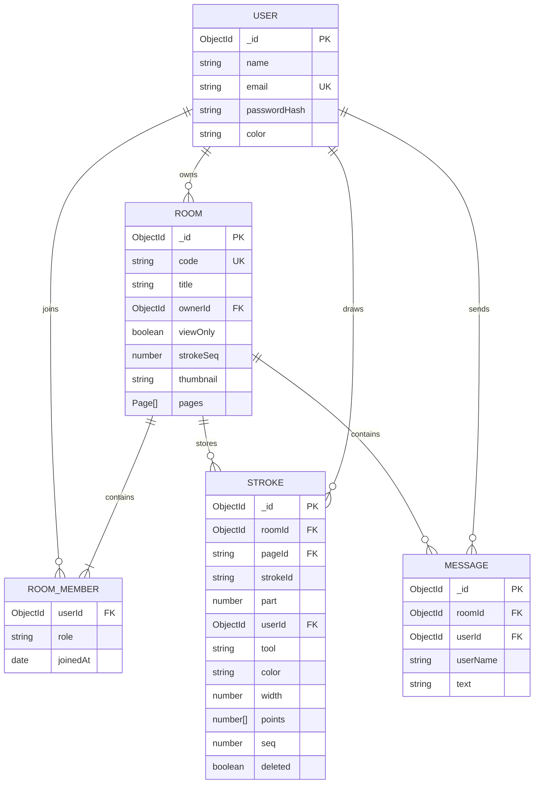

# SketchRoom

SketchRoom is a Next.js App Router application that includes the SketchRoom REST API and a small browser client for exercising it. Flutter is intentionally not included: this web UI is a temporary development/test client, and the REST contract is designed for the later Flutter app.

## Requirements

- Node.js 20.9 or newer (Next.js 16 requirement)
- npm
- MongoDB Atlas database (or another MongoDB deployment)
- Pusher Channels app for presence authentication and event delivery

## Local setup

1. Open a terminal in this project folder.
2. Copy the environment template and edit its values:

   ```powershell
   if (-not (Test-Path .env.local)) { Copy-Item .env.example .env.local }
   ```

3. Set `MONGODB_URI` to the connection string from your Atlas database user, replace `JWT_SECRET` with a long random value, and set all four Pusher values.
4. Install and start:

   ```powershell
   npm install
   npm run dev
   ```

5. Open [http://localhost:3000](http://localhost:3000), register two accounts, create a board, and join it from the second browser/session using the six-character room code.

The starter `.env.local` is only a local template. It contains no working credentials; replace every placeholder before starting the API. Never commit `.env.local` or share its contents.

## MongoDB Atlas

1. Create a MongoDB project and cluster.
2. Create a database user with a strong password. URL-encode special characters in the password in the URI.
3. Add your development machine's current IP under **Network Access**. For a backend deployed to Vercel, add `0.0.0.0/0` because Vercel serverless functions do not use a fixed outbound IP by default. Protect access with a dedicated database user and strong credentials.
4. Copy the Node.js connection string into `MONGODB_URI`, replacing the username, password, and cluster host. Use a database name such as `sketchroom`.
5. Atlas creates collections on the first write. Mongoose defines the collection indexes from the models.

## Pusher Channels

1. Create a Channels app in the Pusher dashboard and note its App ID, Key, Secret, and Cluster.
2. Put those values in `.env.local` as `PUSHER_APP_ID`, `PUSHER_KEY`, `PUSHER_SECRET`, and `PUSHER_CLUSTER`.
3. Enable **Client Events** in the Pusher app settings if you plan to use client-originated cursor/live-stroke events in the later Flutter client. The current web test client uses REST polling and does not send client events.
4. Presence membership is authorized by `POST /api/pusher/auth`. The request needs a valid bearer JWT, a `socket_id`, and a `channel_name` exactly matching `presence-room-<6-character-code>`. The caller must be a room member.

If Pusher is not configured, REST operations still succeed; event-delivery failures are logged and do not roll back database writes. Presence authorization responds with `503` until Pusher is configured.

## Environment variables

| Variable | Required | Purpose |
|---|---:|---|
| `MONGODB_URI` | Yes | MongoDB connection string |
| `JWT_SECRET` | Yes | Secret used to sign seven-day bearer tokens |
| `PUSHER_APP_ID` | For realtime | Pusher Channels application ID |
| `PUSHER_KEY` | For realtime | Public Pusher key |
| `PUSHER_SECRET` | For realtime | Pusher server secret |
| `PUSHER_CLUSTER` | For realtime | Pusher cluster identifier |
| `NEXT_PUBLIC_API_BASE_URL` | No | Optional API origin for the browser test client; defaults to same-origin |

## Browser test client

The dashboard tests registration/login, room creation/joining, member roles and removal, room settings, board strokes, stroke removal, board clear, and chat. It polls the REST API for changes, so it remains useful before the Flutter client is built. Pusher delivery is tested independently by authorizing a presence channel and observing server events with a Pusher client.

### API example

`api.http` contains ready-to-run REST requests for VS Code REST Client and JetBrains HTTP Client. The auth and create-room responses include tokens and room codes; copy them into the variables at the top of the file before running dependent requests.

## REST API

All routes are under `/api`. Except for register and login, send `Authorization: Bearer <JWT>`. JSON input is validated; error responses have `{ "error": "..." }` (validation failures may include `details`) and use appropriate HTTP status codes.

| Method | Path | Access / behavior |
|---|---|---|
| `POST` | `/api/auth/register` | Public; create account and return a JWT |
| `POST` | `/api/auth/login` | Public; verify credentials and return a JWT |
| `GET` | `/api/auth/me` | Authenticated; return current user |
| `GET` | `/api/health` | Public; report whether MongoDB and Pusher are configured and reachable |
| `GET` | `/api/stats` | Public; return stored user, board, stroke, and message counts |
| `GET` | `/api/rooms` | Authenticated; list rooms for current member |
| `POST` | `/api/rooms` | Authenticated; create board as owner; body `{ "title": "...", "viewOnly": false }` |
| `POST` | `/api/rooms/join` | Authenticated; body `{ "code": "ABC234" }`; joins as editor |
| `GET` | `/api/rooms/:code` | Room member; room details, page list, personal bookmarks, and member profiles |
| `PATCH` | `/api/rooms/:code` | Owner; update `title` and/or `viewOnly` |
| `DELETE` | `/api/rooms/:code` | Owner; delete room, strokes, and messages |
| `POST` | `/api/rooms/:code/leave` | Non-owner member; leave room |
| `POST` | `/api/rooms/:code/pages` | Owner/editor unless view-only; create a page; optional body `{ "title": "Notes" }` |
| `PATCH` | `/api/rooms/:code/pages/:pageId` | Room member; bookmark/unbookmark personally with `{ "bookmarked": true }`; owner/editor can also rename using `{ "title": "Notes" }` |
| `DELETE` | `/api/rooms/:code/pages/:pageId` | Owner/editor unless view-only; delete page and its drawings; a room must keep one page |
| `PATCH` | `/api/rooms/:code/members/:userId` | Owner; body `{ "role": "editor" | "viewer" }` |
| `DELETE` | `/api/rooms/:code/members/:userId` | Owner; remove a member |
| `GET` | `/api/rooms/:code/strokes?pageId=<id>&afterSeq=0&limit=2000` | Member; ascending sequence, max 2000, excludes deleted; defaults to first page |
| `POST` | `/api/rooms/:code/strokes` | Owner/editor unless view-only; create a page-scoped, idempotent stroke part |
| `DELETE` | `/api/rooms/:code/strokes/:strokeId` | Stroke author or owner; soft-delete every part |
| `POST` | `/api/rooms/:code/clear` | Owner; body `{ "pageId": "<id>" }`; clear that page's strokes |
| `GET` | `/api/rooms/:code/messages` | Member; latest 200 messages in chronological order |
| `POST` | `/api/rooms/:code/messages` | Member; body `{ "text": "..." }` (max 500 characters) |
| `PUT` | `/api/rooms/:code/thumbnail` | Member; body `{ "image": "data:image/png;base64,..." }` (PNG, max 100 KB) |
| `POST` | `/api/pusher/auth` | Member; authorize `presence-room-<CODE>` |

Stroke body: `{ "pageId": "<id>", "strokeId": "client-generated-id", "part": 0, "tool": "pen", "color": "#20243A", "width": 0.004, "points": [0.1, 0.2, 0.3, 0.4] }`. Coordinates and brush width are normalized to the board. A part accepts at most 500 coordinate numbers. Rooms start with one page and support up to 100. Page bookmarks are personal to each member and are included as `bookmarked` in that member's room response.

### Entity relationship diagram



Room membership and ordered pages are embedded in the Room document; each page stores a title and member bookmark IDs, while `ROOM_MEMBER` in the diagram represents embedded membership records. Strokes have a unique `(roomId, strokeId, part)` index for retry-safe writes and a `(roomId, seq)` index for ordered synchronization.

### Event names

Events are sent to the room's `presence-room-<CODE>` channel: `stroke-added`, `stroke-removed`, `board-cleared`, `page-added`, `page-updated`, `page-deleted`, `member-joined`, `member-role-changed`, `member-kicked`, `room-updated`, `room-deleted`, and `chat-message`. The backend emits server events only; client cursor and live-stroke events belong to the future Flutter client.

## Three-minute demo script

1. **0:00–0:25 — Accounts:** Register as the board owner. Open a private/incognito window and register a second account.
2. **0:25–0:55 — Create/invite:** Create a board in the first window, copy its code, join from the second window, and point out the editor role and member count.
3. **0:55–1:25 — Pages and collaboration:** Add a page, draw different content on multiple pages, bookmark one, then draw in both windows and send a chat message. The temporary dashboard refreshes from the REST API every second.
4. **1:25–1:55 — Permissions:** Change the second account to viewer. Confirm the dashboard disables drawing and that a direct viewer stroke request returns `403`. Switch the role back to editor.
5. **1:55–2:20 — Owner actions:** Rename the room, enable view-only mode, then disable it. Remove a stroke and clear the board.
6. **2:20–2:45 — Presence:** With Pusher configured, authorize `presence-room-<CODE>` using the authenticated endpoint and show presence identity (`name`, `color`, `role`) and server events in a Pusher test client.
7. **2:45–3:00 — Wrap:** Open `/api/health` to show backend connectivity and `/api/stats` to show stored data counts. Then show the room list, chat history, and API request examples. Mention that the Next.js dashboard is only the test client; Flutter Web is a separate follow-up.

## Deploy to Vercel

1. Push this project folder to a Git provider, or import it into Vercel using `sketchroom` as the project root.
2. In Vercel project settings, add `MONGODB_URI`, `JWT_SECRET`, `PUSHER_APP_ID`, `PUSHER_KEY`, `PUSHER_SECRET`, and `PUSHER_CLUSTER` for each environment. Keep secrets in Vercel, not source control.
3. Ensure Atlas network access permits the deployment connection. For Vercel deployments without Static IPs, allow `0.0.0.0/0`; use a dedicated database user with a strong password. For lower latency, place the Atlas cluster in Mumbai (`ap-south-1`) and use Pusher's Asia Pacific (`ap2`) cluster.
4. `vercel.json` pins the deployment region to Mumbai (`bom1`). Deploy; the Next.js route handlers explicitly run on the Node.js runtime, which supports Mongoose and the Pusher server SDK.
5. Verify `/api/auth/register`, then create and join a board from the deployed site. Configure any separately hosted Flutter client to use this deployment's HTTPS base URL.

## Validation

```powershell
npm run lint
npx tsc --noEmit
npm run build
```
# Sketchroom

